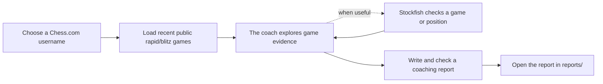

# Chess Coach

Chess Coach looks at a player's recent public Chess.com rapid and blitz games and creates a short, evidence-backed report about what to work on next. Python gathers game facts, an AI model decides what to investigate and what those facts may mean, and Stockfish evaluates positions when asked.

## How it works



## Get started

You will need Python 3.10 or newer, an [OpenAI API key](https://platform.openai.com/api-keys), Stockfish, and a Chess.com account with public rapid or blitz games from the last two years.

In PowerShell, open the project folder and run:

```powershell
python -m venv .venv
.\.venv\Scripts\python -m pip install -r requirements.txt
Copy-Item .env.example .env
```

Add your key to `.env` as `OPENAI_API_KEY=your-key` (without quotation marks). Keep the key private. The default model is `gpt-5.4-mini`; you can change it with `OPENAI_MODEL`. Install [Stockfish](https://stockfishchess.org/) (on Windows, `winget install Stockfish.Stockfish`). If it is not found automatically, set `STOCKFISH_PATH` in `.env` to the full path of `stockfish.exe`.

## Create a report

Replace `YOUR_CHESSCOM_NAME` with the player's Chess.com username:

```powershell
.\.venv\Scripts\python main.py YOUR_CHESSCOM_NAME --games 40
```

The program prints the report's location when it finishes. Reports are saved as Markdown files in `reports/`. The conversation and tool results are saved in `logs/` so you can trace the report's claims to the evidence.

| Option | Default | What it does |
|---|---:|---|
| `--games` | `40` | Number of recent rapid and blitz games to load |
| `--threshold` | `100` | Centipawn evaluation drop that flags a move for review |
| `--max-turns` | `20` | Maximum investigation turns before the coach must report |

Stockfish is available if the coach asks for engine evidence, but it does not analyze every game automatically. A flagged move is worth reviewing, not necessarily a mistake. If the coach reaches its turn limit or cannot finish normally, treat the report as an incomplete reasoning trail rather than a completed recommendation. The AI's self-check can help catch unsupported claims, but it does not guarantee that every conclusion is correct; review the report and its evidence.

## Run offline tests

The tests use sample games and substitutes, so they do not contact Chess.com or OpenAI or run Stockfish:

```powershell
.\.venv\Scripts\python -m unittest discover -s tests -t .
```

## Learn more

- [Set Up and Use the Chess Coach](docs/setup-and-usage.md) — full setup instructions, options, and troubleshooting.
- [How the Chess Coach Agent Works](docs/agentic-workflow.md) — how the tools, AI model, and Stockfish work together.
