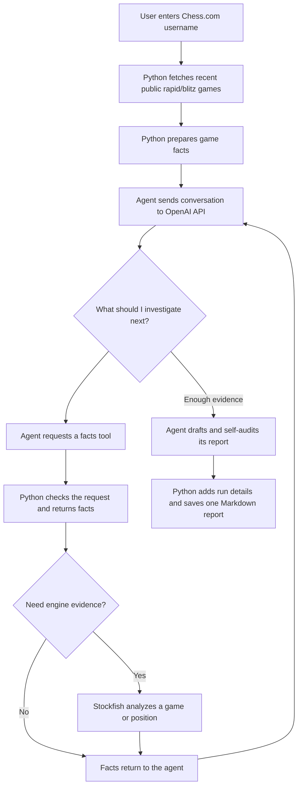
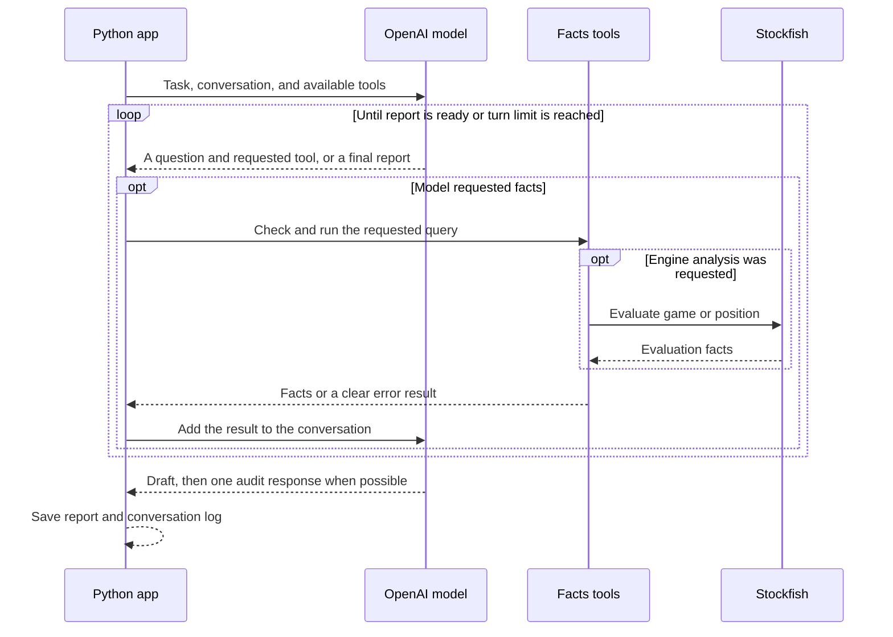

# How the Chess Coach Agent Works

The chess coach turns a player's recent Chess.com games into a short, evidence-backed coaching report. It combines ordinary Python code, an AI model, and Stockfish, with a different job for each:

- **Python** collects game data, calculates facts, checks tool requests, and saves the report.
- **The AI model** decides what to investigate next and what the evidence means for the player.
- **Stockfish** evaluates moves and positions when the agent asks for chess-engine evidence.

This separation matters: a score or move count is a fact; deciding what the player should practice is a coaching judgment.

## From username to report

## How the agent investigates

Before analysis, Python fetches the player's recent public rapid and blitz games from the Chess.com API. It parses information such as moves, openings, game results, and player color. These game facts are available to the agent through tools.

The agent then calls the OpenAI API with the task, the conversation so far, and descriptions of the available tools. On each turn, the model chooses a question and either requests facts or finishes its report. It may, for example, compare opening choices, look at what happened after a familiar line changed, or ask Stockfish to evaluate a position. The next step depends on the answers it has already received; the investigation is not a fixed list of questions.

The tools return measurements and game details, not coaching verdicts. For example, Stockfish can report that a move changed the evaluation; the model decides whether that evidence supports a useful lesson. Engine results are cached during a run, so a repeated request for the same analysis can reuse the earlier result.

## Decisions, checks, and limits

The agent must make its reasoning path visible on tool turns: it states the question it is pursuing, why it chose that question, what could change its mind, and its current conclusion. The program checks that these fields and the requested tool arguments have the expected format. It does not decide whether the reasoning itself is good.

The report must connect its claims to facts the agent actually received, account for sample sizes, rank recommendations, explain confidence, and mention an idea it considered but rejected. When the model first submits a report and turns remain, it gets one opportunity to check its claims, numbers, move attribution, arithmetic, and recommendations against the tool results.

These checks improve traceability, but they are not a guarantee that every claim is true. The self-audit is performed by the same model, and the program does not independently prove the quality of a coaching judgment. A person should still review the report and its evidence.

| Check or limit | What it means |
|---|---|
| Reply format | The program expects a JSON response in the agreed format and gives malformed replies a limited number of retries. |
| Tool requests | Python validates each tool request. Errors are returned to the model rather than treated as evidence. |
| Investigation limit | The default cap is 20 valid turns. If reached, the agent is asked for its best report using the facts gathered so far. |
| Evidence | The report should cite observed game facts and engine results; game outcomes alone do not prove why a move was good or bad. |
| Self-audit | One model review may catch unsupported details, but it cannot guarantee correctness. |
| External services | A full run needs Chess.com access, an OpenAI API key, and Stockfish installed. |

## What the run produces

At the end of an agent run, the program writes one Markdown file in `reports/`. Python writes the report header with the username, date, number of games, model, turn count, and audit status. The model writes the report's coaching sections. The conversation, including tool results, is also saved under `logs/` so a reader can trace its evidence.

The report should help the player answer: **What should I work on first, why does the evidence support it, and what other approach did the agent consider but reject?**

## How to explain or assess this project

The project connects to the course criteria in these concrete ways:

| Course criterion | Evidence to point to |
|---|---|
| **Working agent** | Run `main.py` with a Chess.com username and show the generated report and saved conversation. |
| **Understanding** | Explain what Python, the OpenAI model, and Stockfish each do, and describe one investigation choice the model made. |
| **Clear explanation** | Walk through the workflow diagram: API call, decision loop, evidence checks, and report output. |
| **Real problem** | Show how a player can use evidence from their own recent games to prioritize what to study. |

For the five-minute class presentation, a simple path is: explain the player's problem, show one model decision and the facts behind it, then open the generated report and describe its first recommendation.

The key agentic decision is not simply which tool to call: it is what coaching lesson and next action best fit the evidence for this player. To verify the program's deterministic behavior without external services, run the offline tests described in [Setup and Usage](setup-and-usage.md).

For implementation details, see [Agent Loop](agent-loop.md), [Tools](tools.md), and [Data Flow](data-flow.md).
