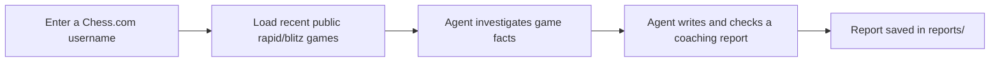

# Set Up and Use the Chess Coach

This guide gets the chess coach running on your computer. You will need Python, a Stockfish chess engine, and an OpenAI API key. The program downloads recent public rapid and blitz games for a Chess.com username, then writes a coaching report.

## What happens when you run it?



## Before you start

- Install Python 3.10 or newer.
- Install [Stockfish](https://stockfishchess.org/). On Windows, you can use:
  ```powershell
  winget install Stockfish.Stockfish
  ```
- Have an OpenAI API key ready. Keep it private; do not share it or publish it.
- Use a Chess.com username with public rapid or blitz games from the last two years.

## Install the project

Open PowerShell in the project folder and run:

```powershell
python -m venv .venv
.\.venv\Scripts\python -m pip install -r requirements.txt
Copy-Item .env.example .env
```

Open the new `.env` file and replace the example value for `OPENAI_API_KEY` with your own key. Do not include quotation marks. If Stockfish is not found automatically, set `STOCKFISH_PATH` to the full path of `stockfish.exe`, for example:

```text
STOCKFISH_PATH=C:\path\to\stockfish.exe
```

You can leave `OPENAI_MODEL` unchanged to use the default model, `gpt-5.4-mini`.

## Run a report

Replace `YOUR_CHESSCOM_NAME` with the player's Chess.com username:

```powershell
.\.venv\Scripts\python main.py YOUR_CHESSCOM_NAME --games 40
```

The program prints the report's file path when it finishes. Open that Markdown file in `reports/`.

Useful options:

| Option | Default | What it changes |
|---|---:|---|
| `--games` | `40` | How many recent rapid and blitz games to load |
| `--threshold` | `100` | Engine score drop, in centipawns, that flags a move for review |
| `--max-turns` | `20` | Maximum number of investigation turns before the agent must report |

For example, to analyze up to 20 games:

```powershell
.\.venv\Scripts\python main.py YOUR_CHESSCOM_NAME --games 20
```

The agent may not analyze every game with Stockfish. It asks the engine about games or positions when it needs that evidence. The Stockfish program must still be installed so it is available if requested.

## Understand the files

- `reports/` contains one Markdown coaching report per run.
- `logs/` contains the conversation and tool results used during a run. Use it to trace report claims back to evidence.
- Progress messages appear in the PowerShell window while the program runs.

A report may note that the agent reached its turn limit or could not finish normally. Treat an incomplete report as a reasoning trail, not a completed coaching recommendation.

## Run the offline tests

To check the project without contacting Chess.com or OpenAI or running Stockfish:

```powershell
.\.venv\Scripts\python -m unittest discover -s tests -t .
```

The tests use sample games and substitutes for external services.

## Common problems

| What you see | What to check |
|---|---|
| “Could not find a Stockfish binary” | Install Stockfish, or set `STOCKFISH_PATH` to the location of `stockfish.exe`. |
| “No rapid/blitz games found” | Check the username and whether the account has public rapid or blitz games in the last 24 months. |
| An OpenAI authentication error | Check that `.env` contains a valid `OPENAI_API_KEY`. |
| An incomplete report | Check the error printed in PowerShell and the run transcript in `logs/`. |
| A “Cap reached” note | The agent used its allowed turns. Try fewer games or increase `--max-turns`. |

For a plain-language explanation of how the agent investigates and reaches its recommendations, see [Agentic Workflow](agentic-workflow.md).

## More about the project

Python gathers and checks game facts, the AI model chooses what to investigate and how to interpret the evidence, and Stockfish evaluates positions when asked. The project is organized around those responsibilities:

| Guide | What it explains |
|---|---|
| [Agentic Workflow](agentic-workflow.md) | Project parts, available facts tools, the model's decision loop, evidence checks, report output, and course criteria |
